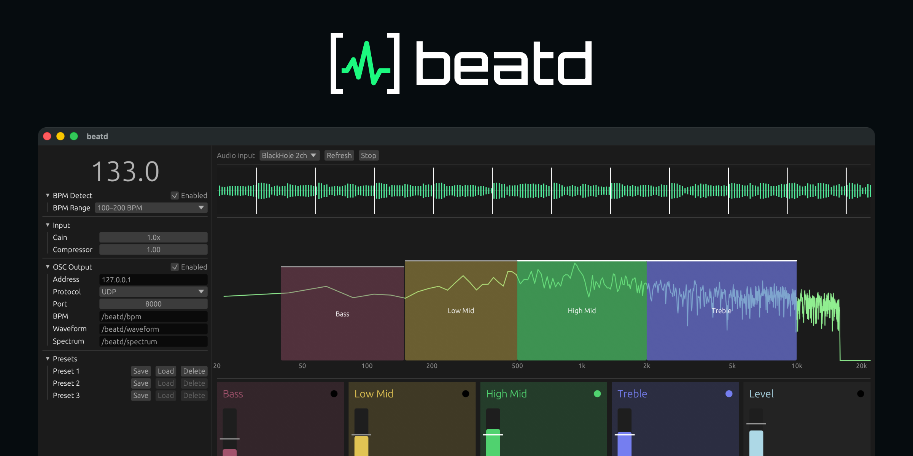
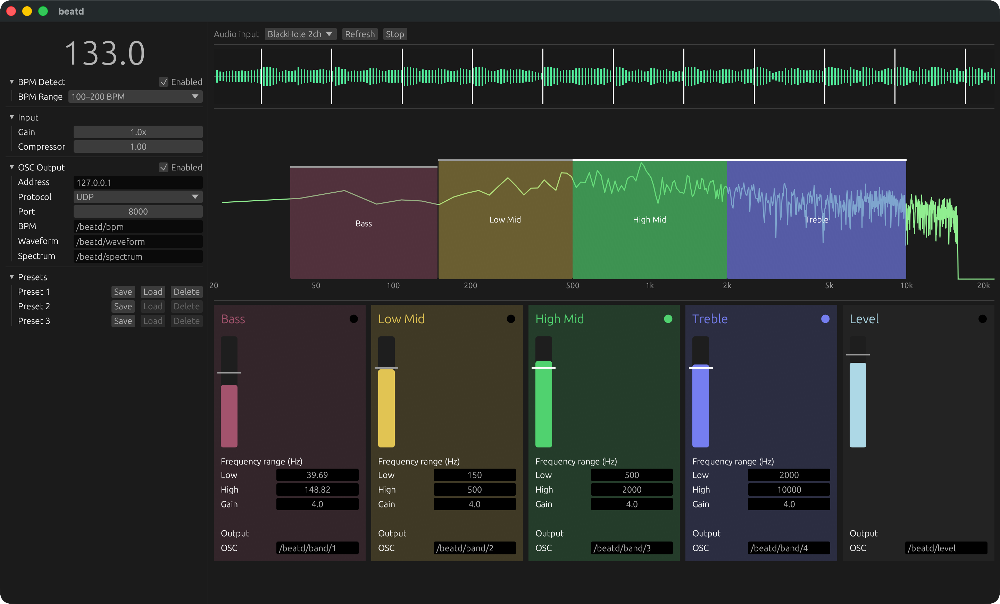

# beatd

[](https://github.com/nuskey8/beatd/actions/workflows/ci.yml)
[](https://github.com/nuskey8/beatd/releases/latest)
[](https://crates.io/crates/beatd)
[](https://www.npmjs.com/package/beatd-js)
[](https://www.nuget.org/packages/Beatd)
[](https://github.com/nuskey8/beatd/tree/main/beatd-dotnet/Beatd.Unity/Packages/com.nuskey8.beatd.unity)

[English](README.md) | 日本語

GUI application and library for streaming audio analysis and OSC conversion.



## 概要

beatdはストリーミング音声解析のためのクロスプラットフォームなアプリケーション・ライブラリです。

[Sound2Light](https://github.com/ETCLabs/Sound2Light)のモダンな再実装をコンセプトにスタートし、Rust実装でクロスプラットフォームかつ扱いやすいGUIを作成しました。音声解析の結果をOSCで送信し、外部のVJソフト等と連携することが可能です。

また、解析のコア部分はRust・C・C#(.NET/Unity)・JavaScript(WebAssembly)向けのアプリケーションに組み込めるよう、独立したライブラリとして提供されています。

## スクリーンショット



## インストール

GitHubの[Releases](https://github.com/nuskey8/beatd/releases/latest)から最新のリリースを選択し、該当するOSの実行ファイルをダウンロードします。

### macOS

macOS版はApple Developer IDによる署名・公証を行っていないため、初回起動時に「開発元を確認できないため開けません」などと表示されることがあります。

開くには、以下のいずれかを行ってください。

1. `beatd.app` を右クリック(またはControlキーを押しながらクリック)し、「開く」を選んでもう一度「開く」をクリックする
2. 一度起動を試したあと、**システム設定 → プライバシーとセキュリティ** から「このまま開く」を選ぶ
3. ターミナルでquarantine属性を削除する

```sh
xattr -dr com.apple.quarantine /Applications/beatd.app
```

## libbeatd

beatdのストリーミング音声解析は独立したcrateとしてRustで実装されています。これを組み込むことで、BPM解析などをアプリケーション内で利用することが可能です。

### Rust

cargoからcrateを追加します。

```sh
cargo add beatd
```

```rust
use beatd::Analyzer;

let mut analyzer = Analyzer::new(48_000);

// samples: &[f32] (1.0〜1.0)
analyzer.push(&samples);

let level = analyzer.level();
let bpm = analyzer.bpm();
let spectrum = analyzer.spectrum();
let waveform = analyzer.waveform();
let beats = analyzer.beat_offsets(bpm);
```

### C

`ffi` featureを有効にしてライブラリをビルドします。

```sh
cargo build -p beatd --features ffi
```

出力される `libbeatd.so` / `libbeatd.dylib` / `beatd.dll` と`beatd/beatd.h` をプロジェクトに追加し、リンク時に `-lbeatd` を指定します。

```c
#include "beatd.h"

beatd_analyzer *analyzer = beatd_new(48000);
if (analyzer == NULL) {
    return 1;
}

beatd_set_bpm_range_min(analyzer, 75);
beatd_push(analyzer, samples, count);

float level = beatd_level(analyzer);
float bpm = beatd_bpm(analyzer);

float spectrum[1024];
size_t bins = beatd_spectrum(analyzer, spectrum, 1024);

beatd_free(analyzer);
```

### JavaScript

npmからライブラリを追加します。

```sh
npm i beatd-js
```

```js
import { createAnalyzer } from "beatd-js";

using analyzer = createAnalyzer({ sampleRate: 48000 });

// samples: Float32Array
analyzer.push(samples);

console.log(analyzer.level(), analyzer.bpm());
console.log(analyzer.spectrum());
console.log(analyzer.waveform());
console.log(analyzer.beatOffsets(analyzer.bpm()));
```

### C# / Unity

.NETプロジェクトの場合、NuGetからパッケージを追加できます。

```sh
dotnet package add Beatd
```

Unityの場合、Package Managerからgit URLでパッケージを追加できます。

```
https://github.com/nuskey8/beatd.git?path=beatd-dotnet/Beatd.Unity/Packages/com.nuskey8.beatd.unity
```

```csharp
using Beatd;

using var analyzer = new BeatdAnalyzer(48_000);
analyzer.BpmRangeMin = 75;

analyzer.Push(samples); // ReadOnlySpan<float>

Console.WriteLine($"{analyzer.Level}, {analyzer.Bpm}");
float[] spectrum = analyzer.GetSpectrum();
float[] beats = analyzer.GetBeatOffsets(analyzer.Bpm);
```

なお、.NET/Unity版は現在以下のプラットフォームにのみ対応しています。

| プラットフォーム    | RID         | .NET (NuGet) | Unity |
| :------------------ | :---------- | :----------: | :---: |
| Windows x64         | `win-x64`   |      ✅      |  ✅   |
| Linux x64           | `linux-x64` |      ✅      |  ✅   |
| macOS Intel         | `osx-x64`   |      ✅      |  ✅   |
| macOS Apple Silicon | `osx-arm64` |      ✅      |  ✅   |

## ライセンス

beatdは[MIT License](LICENSE)の下で公開されています。
