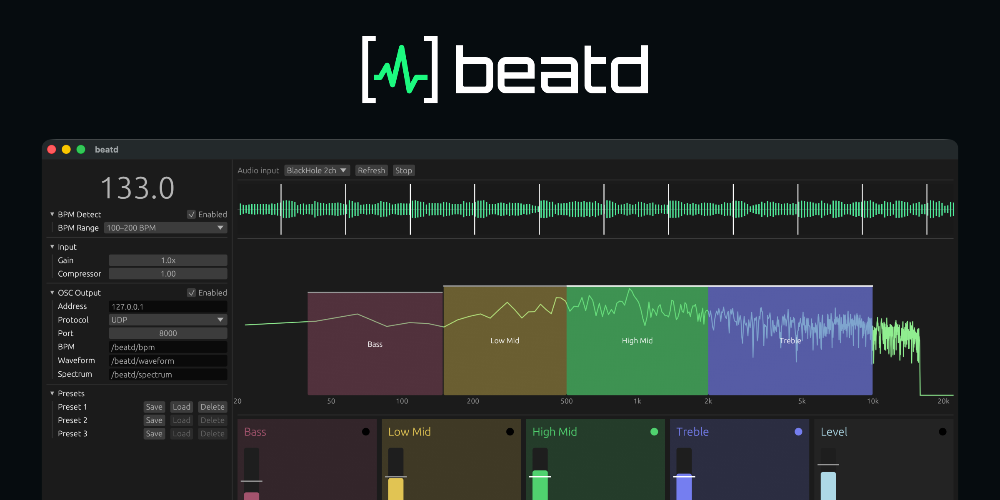
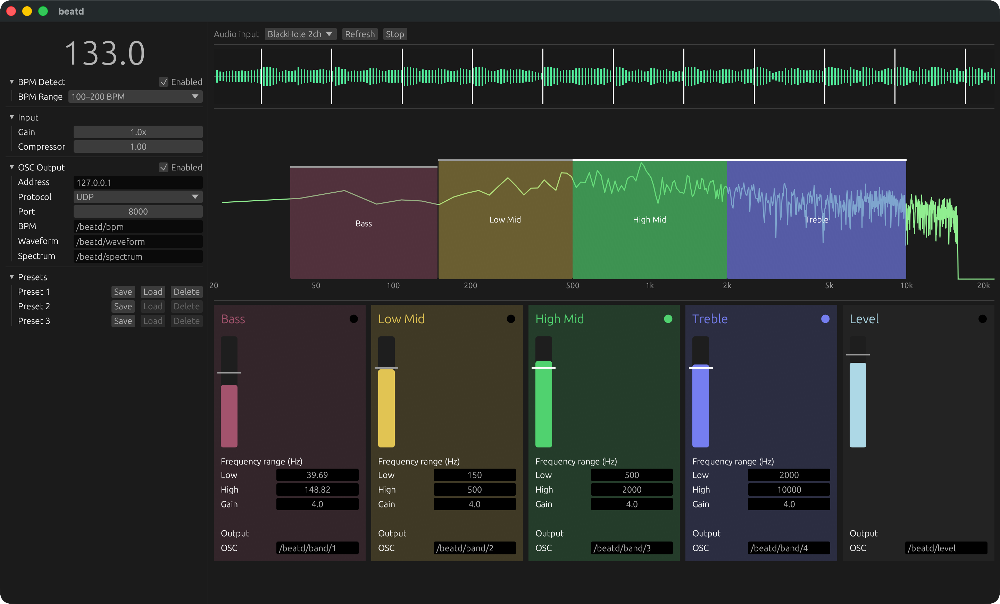

# beatd

English | [日本語](https://github.com/nuskey8/beatd/blob/main/README.ja.md)

GUI application and library for streaming audio analysis and OSC conversion.



## Overview

beatd is a cross-platform application and library for streaming audio analysis.

It started with the concept of being a modern reimplementation of [Sound2Light](https://github.com/ETCLabs/Sound2Light), utilizing a Rust implementation to create an easy-to-use, cross-platform GUI. It can send audio analysis results via OSC to integrate with external VJ software and similar tools.

Additionally, the core analysis engine is provided as an independent library so that it can be embedded into applications for Rust, C, C# (.NET/Unity), and JavaScript (WebAssembly).

## Screenshot



## Installation

Select the latest release from GitHub [Releases](https://github.com/nuskey8/beatd/releases/latest) and download the executable file for your operating system.

## libbeatd

The streaming audio analysis in beatd is implemented in Rust as an independent crate. By embedding this, you can use features such as BPM analysis within your applications.

### Rust

Add the crate via cargo.

```sh
cargo add beatd
```

```rust
use beatd::Analyzer;

let mut analyzer = Analyzer::new(48_000);

// samples: &[f32] (-1.0 to 1.0)
analyzer.push(&samples);

let level = analyzer.level();
let bpm = analyzer.bpm();
let spectrum = analyzer.spectrum();
let waveform = analyzer.waveform();
let beats = analyzer.beat_offsets(bpm);
```

### C

Build the library with the `ffi` feature enabled.

```sh
cargo build -p beatd --features ffi
```

Add the generated `libbeatd.so` / `libbeatd.dylib` / `beatd.dll` along with `beatd/beatd.h` to your project, and specify `-lbeatd` during linking.

```c
#include "beatd.h"

beatd_analyzer *analyzer = beatd_new(48000);
if (analyzer == NULL) {
    return 1; 
}

beatd_set_bpm_range_min(analyzer, 75);
beatd_push(analyzer, samples, count);

float level = beatd_level(analyzer);
float bpm = beatd_bpm(analyzer);

float spectrum[1024];
size_t bins = beatd_spectrum(analyzer, spectrum, 1024);

beatd_free(analyzer);
```

### JavaScript

Add the library via npm.

```sh
npm i beatd
```

```js
import { createAnalyzer } from 'beatd';

using analyzer = createAnalyzer({ sampleRate: 48000 });

// samples: Float32Array
analyzer.push(samples);

console.log(analyzer.level(), analyzer.bpm());
console.log(analyzer.spectrum());
console.log(analyzer.waveform());
console.log(analyzer.beatOffsets(analyzer.bpm()));
```

### C# / Unity

For .NET projects, you can add the package from NuGet.

```sh
dotnet add package Beatd
```

For Unity, you can add the package from the Package Manager using the git URL.

```
https://github.com/nuskey8/beatd.git?path=beatd-dotnet/Beatd.Unity/Packages/com.nuskey8.beatd.unity
```

```csharp
using Beatd;

using var analyzer = new BeatdAnalyzer(48_000);
analyzer.BpmRangeMin = 75;

analyzer.Push(samples); // ReadOnlySpan<float>

Console.WriteLine($"{analyzer.Level}, {analyzer.Bpm}");
float[] spectrum = analyzer.GetSpectrum();
float[] beats = analyzer.GetBeatOffsets(analyzer.Bpm);
```

## License

beatd is released under the [MIT License](https://github.com/nuskey8/beatd/blob/main/LICENSE).
